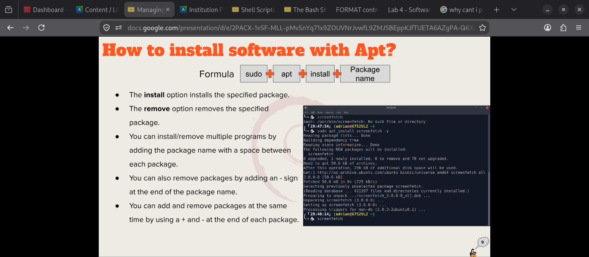

# Notes 4

## How to install and remove software using the APT command. Include several well documented examples as you will need to install software later.

### Step one: open your terminal

### Step two:type screen fetch

### Step three: type this sudo apt install screenfetch -y

### Step four: screen fetch

## How to create a shell script step by step including screenshots and how to run it. Try to be as detailed as possible. You will have to create a script in your final exam.

### 1.Open text editor "the notebook with the pencil icon"

### 2. Input on the first line  `#!/bin/bash`

### 3.Go to the hamburger & save it as `whateveryouneedtonameit.sh`
#### Example 
`lab4-script3.sh`

### 4.Open Tilix and type in `bash ~/scripts/lab4-script3.sh`
the whole purpose to input`bash ~/` in then comes the folder you save the text editor at.

### 5.Text editor is where you input the commands you want such as `echo` and Tilix is where you see the finish product of your work.

### 6. Do not forget to save the work on the text editor by going to the hamburger and hitting save.

### 7. On Tilix you can always hit the arrow up on the keyboard to gain the `bash~/` who line with the description and hit enter to always preview the new changes.