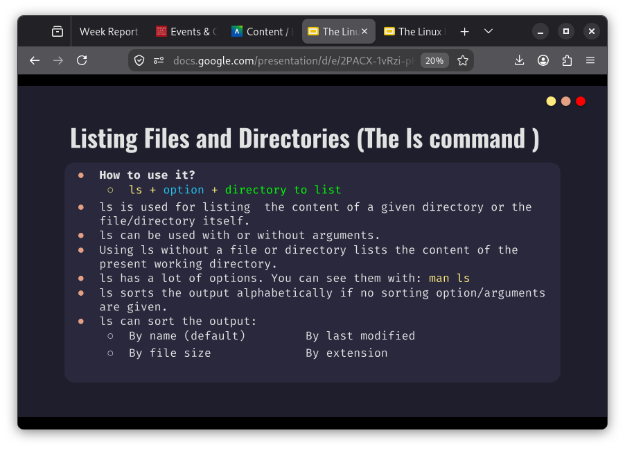
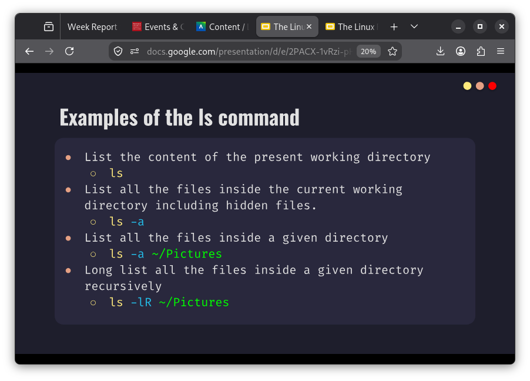
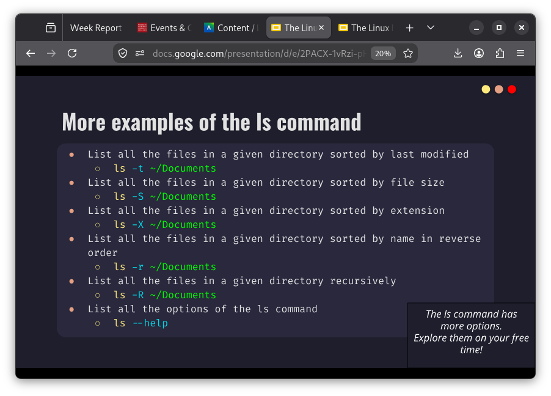
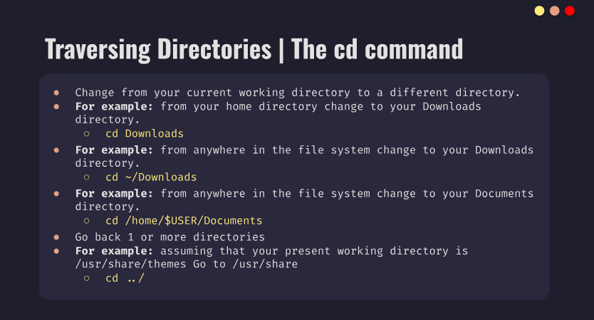
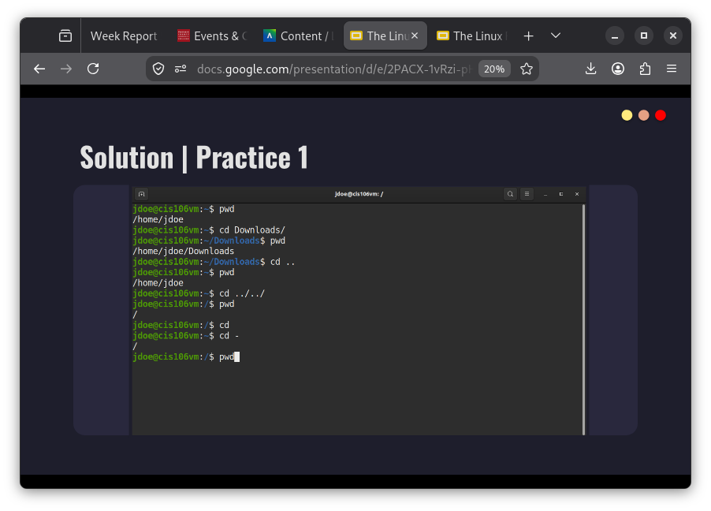
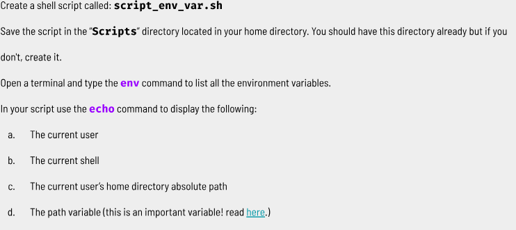
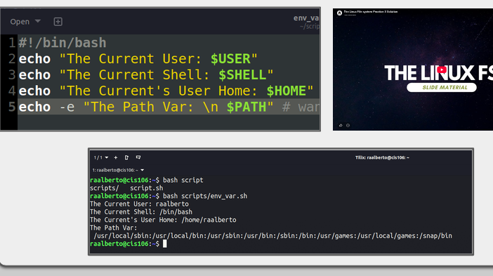
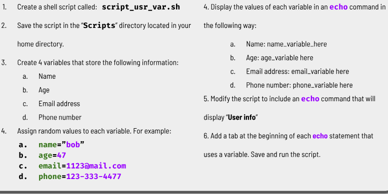
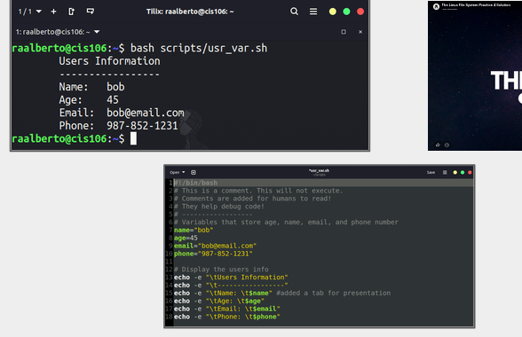

## ls
* **Usage**
Used for displaying all the files inside a given directory. When no directory is specified, ls displays the files in th current working directory

* **Formula**
  * `ls+option+directory`

* **Examples**
  
  
  

## pwd
* **Usage**
  * used for displaying the current working directory(where you are currently working)

* **Formula**
  * `pwd`

* **Examples**

  * type `pwd`
home/amazingg <---this will appear

## cd  
* **Usage**
  * used for changing the current working directory.When no directory is given,cd changes the current working directory to the home directory of the current user.
* **Formula**
* `cd+destination`
* Destination can be an absolute path or a relative path.

* **Example**
* If you want to go to your home directory you can use:
  *  cd
  *  cd~
  *  cd `$home`
*  If you want to go to the previous current working directory you can use 
   *  **cd ~
  

Relative path

#### What is a variable?
Variables allow you to temporarily store information within the shell script for use with other commands in the script.A variable is a container or placeholder for data

#### How do I use a variable?
`user="Bob"`

#### What is an environment variable?
Environment variables are used by the shell to track specific system information.Environment variable are typed in capital letter.This helps to differentiate them from user defined. Type their name starting with a dollar sign$ 
Example: `echo MONEYSIGNuser` to display the current user

#### What is a user defined variable?
Allows you to temporarily store data and use it throughout the script-just like any other programming language.User variables are created by the user and exist only in the script and subshell that runs the script.

#### What is the root directory? 
Contains all the files and subdirectories that makes your computer

#### What does “Parent Directory” mean?
You are always working inside a particular directory and you can move forward to a subdirectory or backwards to the previous directory.

#### What does “Current working directory” mean?
The directory where you are at the moment or present working directory.

#### What is an absolute path? Include an example
the location of a file starting a the root of the file system.
**Example**
* /home/john/downloads/song.mp3
IT BEGINS WITH THIS `/`

#### What is a relative path? Include an example
THe location of a file startig from the current working directory or a directory that is located inside the current working directory. 
  **Example**

  * Downloads/song.mp3
IT DOES NOT BEGIN WITH `/`

#### What is the difference between “Your home directory” and “The home directory”?
When you open your terminal emulator , your current working directory is your home directory. It refers to your user's home directory. For example , /home/adrian is the home directory of the user adrian.
THe phrase "the home directory" refers to the home directory located in the root. This: /home
