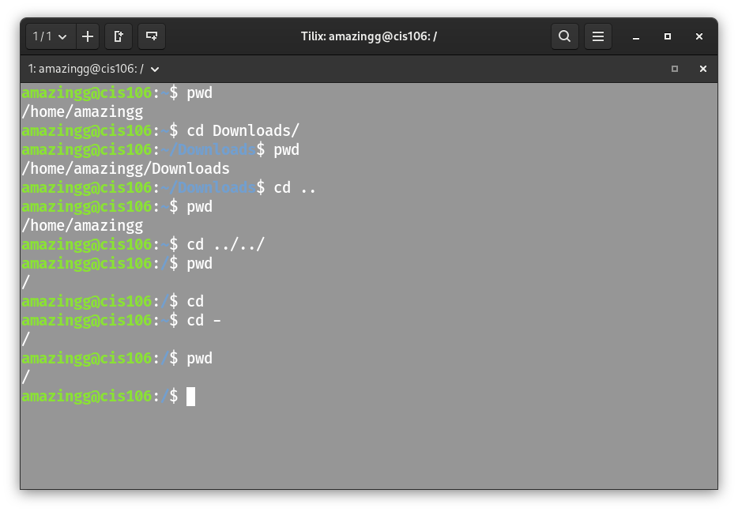
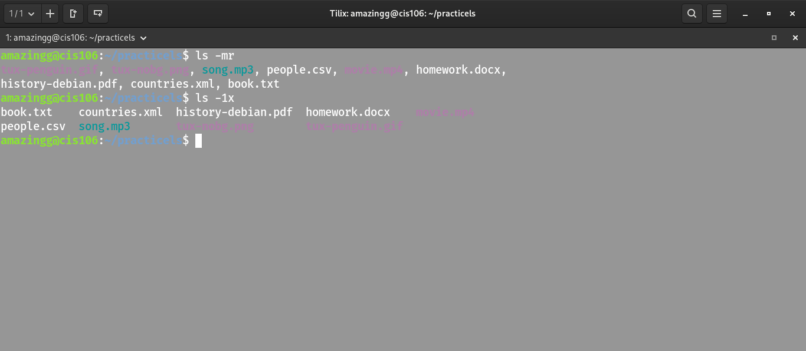
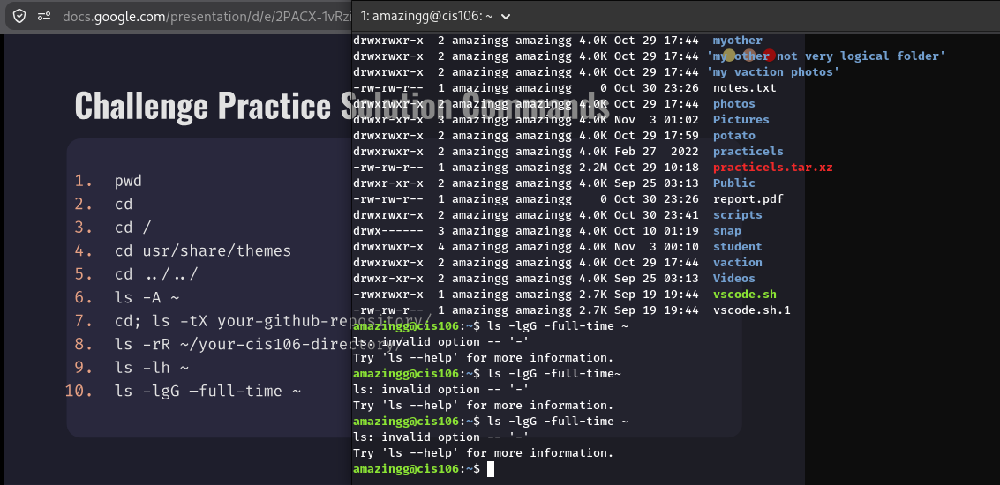
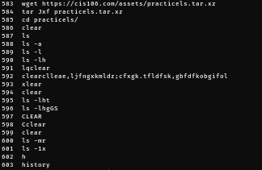
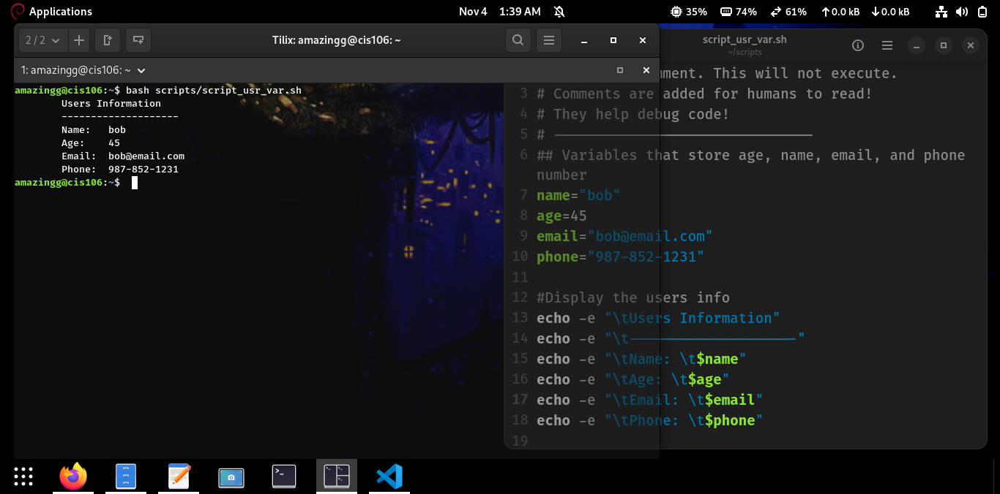

# Week Report 5

## Practice The Linux Filesystem: 

1. 
2. 
3. 

## Practice Shell Scripting Chapter 2 

1. 
2. 

* Links
  
* [lab 5](../../labs/lab5/lab5.md)
  
* [Note5](../../notes/notes5/notes5.md)  
